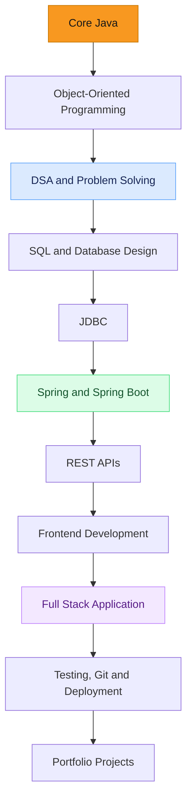
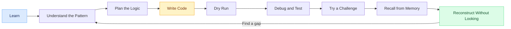
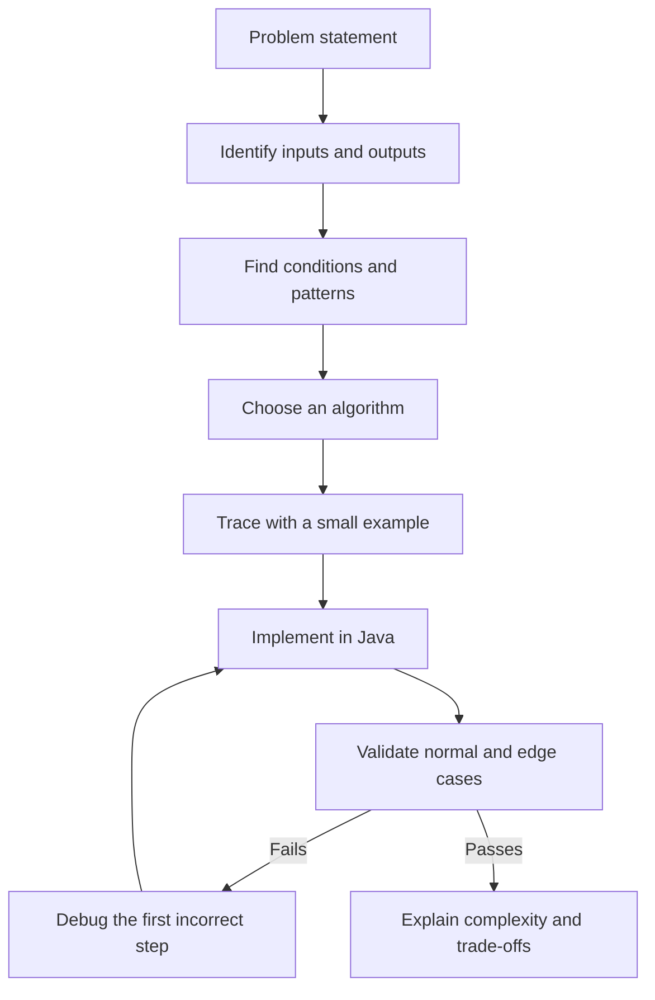

<div align="center">

<!-- Animated typing header -->
<a href="https://git.io/typing-svg">
  
</a>

<p><b>A hands-on learning repository — from Core Java fundamentals toward Java Full Stack Development.</b></p>


<br />

<!-- Optional animated coding GIF; replace with a locally hosted GIF if preferred -->


</div>

---

## 👋 About This Repository

This repository documents my progress as I learn Java and work toward becoming a **Java Full Stack Developer**.

I'm not aiming to memorize programs. I'm building the ability to understand a problem, recognize a pattern, design a solution, write and debug code, and reconstruct the logic independently.

> **Principle:** Understand the pattern. Build the logic. Verify it with code.

## 🧭 Roadmap



<details>
<summary><b>Roadmap stages and focus</b></summary>

| Stage | Topics | Outcome |
|---|---|---|
| 1. Core Java | Variables, conditions, loops, methods, arrays, strings | Write readable Java programs |
| 2. OOP | Classes, objects, encapsulation, inheritance, polymorphism, abstraction | Organize code around clear responsibilities |
| 3. DSA | Searching, sorting, recursion, data structures, complexity | Solve problems and explain trade-offs |
| 4. Databases | SQL, schema design, joins, subqueries, constraints | Model and query data confidently |
| 5. Java backend | JDBC, Spring, Spring Boot, REST APIs | Build backend services |
| 6. Frontend | HTML, CSS, JavaScript and a frontend framework | Build usable interfaces |
| 7. Engineering | Testing, Git, debugging, security, deployment | Ship maintainable applications |

</details>

## 🔁 My Learning Workflow



Each topic should move beyond “it works” toward **why it works**, edge cases, debugging, and independent reconstruction.

## 🏗️ How I Think About a Program



## 📈 Current Learning Snapshot

> This is a learning-in-progress repository. The roadmap describes the intended direction; it does not mean every technology below is already completed.

- **Current focus:** Core Java, arrays, strings, searching, sorting and recursion
- **Practice style:** Small programs, menu-driven analyzers, dry runs, debugging and recall exercises
- **Next direction:** Strengthen OOP, then databases and backend development

### Current topic map

```mermaid
flowchart LR
    A[Java fundamentals] --> B[Methods and arrays]
    B --> C[Strings]
    C --> D[Searching and sorting]
    D --> E[Recursion]
    E --> F[OOP]
    F --> G[SQL and JDBC]
    G --> H[Spring Boot and APIs]
    H --> I[Full Stack Projects]

    classDef active fill:#fff0d9,stroke:#f89820,color:#422006,stroke-width:2px
    class A,B,C,D,E active
```



## 📂 Suggested Repository Structure

As the repository grows, I plan to keep examples grouped by topic rather than placing every Java file in one folder.

```text
java-full-stack-journey/
├── README.md
├── src/
│   └── main/java/
│       └── learning/
│           ├── basics/          # Variables, conditions and loops
│           ├── methods/         # Method design and reuse
│           ├── arrays/          # Array traversal and operations
│           ├── strings/         # Character and string problems
│           ├── searching/       # Linear and binary search
│           ├── sorting/         # Bubble, selection and insertion sort
│           ├── recursion/       # Recursive patterns and tracing
│           └── oop/             # Classes and object-oriented design
├── notes/                       # Concepts, patterns and dry runs
└── projects/                    # Small projects and integrated practice
```

*The structure above is a suggested organization. Adjust it to match the folders that actually exist in this repository.*

## 🧠 Problem-Solving Checklist

Before calling a problem complete, I aim to check:

- [ ] Can I explain the problem in my own words?
- [ ] Can I identify the pattern and explain why it fits?
- [ ] Can I write the logic before looking at a solution?
- [ ] Can I dry-run the code with sample input?
- [ ] Have I tested edge cases, including empty, small or unusual inputs where relevant?
- [ ] Can I explain the time and space complexity?
- [ ] Can I reconstruct the solution later without copying it?

## 🛠️ Tools and Technologies

<p>
  
</p>

Technologies are added to the project as I learn and use them. Listing a tool here represents part of my learning toolkit, not a claim of professional mastery.

## 🎯 Long-Term Goal

Build and deploy useful applications with **Java, Spring Boot, SQL, REST APIs, and a frontend**, supported by strong fundamentals in data structures, operating systems, networking, testing, security, and debugging.

## 🤝 Follow the Journey

I'm using this repository as a record of consistent practice, mistakes, improvements, and projects. Suggestions and constructive feedback are welcome.

<div align="center">
  <sub>Built one concept at a time · Practiced with purpose · Improved through debugging</sub>
</div>
